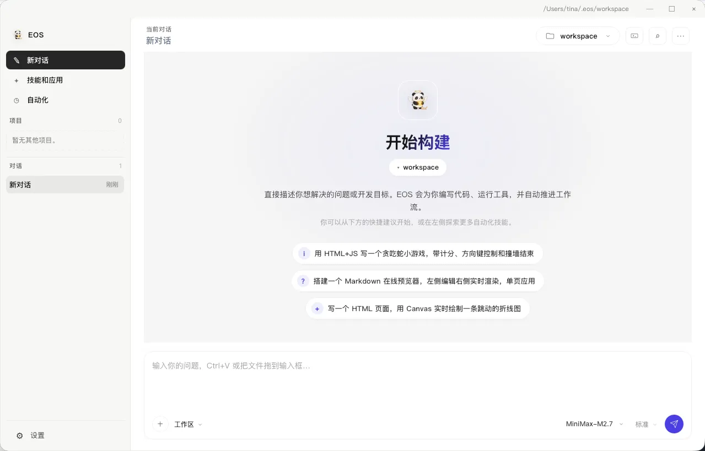

# EOS App

[中文](./README.md) | [English](./README.en.md)

**A desktop AI coding workspace.** Work with AI on local projects and inspect file changes, command output and task progress in one window.

- Download: [Releases](https://github.com/eosaios/eos-app/releases) (always use the latest release)
- Issues: [Issues](https://github.com/eosaios/eos-app/issues)
- Terminal edition: [EOS CLI](https://github.com/eosaios/eos)

This repository is the **official distribution repo** for EOS App: installers, release notes, and product information — **not** the desktop source code. Core capabilities are built on the Rust core of [EOS CLI](https://github.com/eosaios/eos). Official packages include Core integrity checks (SHA-256 and Ed25519 verification). Core verification is separate from operating-system signing of the application package, which depends on the particular release.

## Why EOS App

Work on project conversations, inspect changes, run terminal commands and check pages through the available browser backend in one workspace.

- **Coordinate tasks** — conversations, plans, tasks and approvals in one place
- **Use the browser** — navigation, clicks, forms and human takeover, with platform-dependent backends
- **Inspect the work** — Git status, diffs, command output and previews of supported artifact formats
- **Configure and maintain** — themes, reply preferences, in-app update checks and system tray

## Capabilities and requirements

**Conversations and projects**

Project chats, attachments, plan / auto modes, input refinement and saved reply snippets; tasks and plan todos, Git status and diffs, commits / pushes, worktrees and remote-repository operations. Prepare Git, project toolchains and repository credentials as needed.

**Browser**

macOS / Windows have native embedded browser hosts; Linux defaults to a separate browser engine. Supported backends provide navigation, clicks, forms and human takeover. Available actions depend on the backend, browser runtime and site restrictions; for example the embedded macOS backend does not support browser-tool PDF export. Feature parity across platforms is not implied.

**Permissions and execution policies**

Configure approvals, tool policies and sandbox levels. Current policy checks are not complete operating-system isolation; consult the backend status shown in the app. Review commands and changes before adopting them.

**Models, context and usage**

Configure model connections and check connectivity; manage rules, memory and context. Tools, vision, reasoning controls and context limits depend on the model and endpoint. Usage depends on provider-reported data; cost estimates may be unavailable without usage or pricing information. The provider invoice is authoritative.

**Extensions and automation**

Skills, MCP connections, plugin marketplace, themes and compatible local / GitHub theme imports. Marketplace installation and online services may require sign-in and entitlement; LSP requires its language server. Scheduled automations run only while EOS App is running and stop when the app exits.

**Terminal and desktop**

Integrated terminal, system tray, single instance and desktop notifications. The Windows terminal needs Bash, for example Git for Windows; Windows may need WebView2. Linux needs compatible WebKit / GTK desktop libraries. Check the corresponding release notes for platform and version availability.

## Platforms & install

| Platform | Arch | How to install |
|---|---|---|
| Windows | x64 | setup installer, or portable zip |
| macOS | Intel / Apple Silicon | dmg drag-and-drop, or portable tar.gz |
| Linux | amd64 / arm64 | tar.gz |

1. Open [Releases](https://github.com/eosaios/eos-app/releases) and download the latest package for your platform
2. Verify with `SHA256SUMS.txt` on the same page if needed
3. Check and download updates in-app, then initiate installation. Windows / macOS use their platform installer flows; Linux opens the download folder for manual extraction and replacement.

> Asset names follow each Release page. Version numbers move with releases and are not repeated in this document.

## Screenshots

### Demo video (about 80 seconds)

Click the preview for the full walkthrough — conversation, task execution, and file generation.

Example workspace on macOS; layout can differ by system and release:

- Left: new chat, skills and apps, automation, plus tasks / worktree, usage / network / memory / help
- Center: conversation and the main workflow
- Bottom: input for new tasks (switch model and reasoning level); Bash terminal docked below

## License and costs

**Desktop source code is not public. Official binaries are free for personal and commercial work.** See [LICENSE](./LICENSE) for the full terms.

This free-use grant also covers official, unmodified EOSAIOS binaries released previously. Older packages or historical snapshots may still contain earlier wording; see section 6.2 of the [current main-branch license](https://github.com/eosaios/eos-app/blob/main/LICENSE) for the current grant.

- Individuals and organizations may use official, unmodified binaries for internal work, commercial software development and paid client projects without a separate commercial-use license
- Unmodified sharing of official packages and public docs is allowed with the license, copyright notices and official source retained
- Free use does not grant desktop source rights or permission to repackage or sell EOS App itself
- Model API credits are not included; your provider determines API charges and data policies
- The standalone EOS CLI distribution and third-party components retain their own licenses

## First use and limitations

1. Download the official package for your system and check its release notes and SHA-256 checksums.
2. Add your provider endpoint, API key and model in model settings, then test the connection. BYOK coding does not require an EOS account; account services have their own sign-in requirements.
3. Open a test project, choose execution permissions and request a small change. Review the diff and command output, then run the project tests before adopting the result.

Model requests go to your configured endpoint and can include messages, file contents, project context, command output and screenshots. Websites, plugins, MCP, updates and account features can also use the network; check the enabled services' data policies. Tool calling, vision, context limits and reasoning support vary by model and endpoint. Costs are estimates; your provider's bill is authoritative. Approvals and sandbox policies do not replace review or guarantee correct results.

## Contact

- Issues: https://github.com/eosaios/eos-app/issues
- Partnerships / redistribution licensing: legal@eosaios.com
