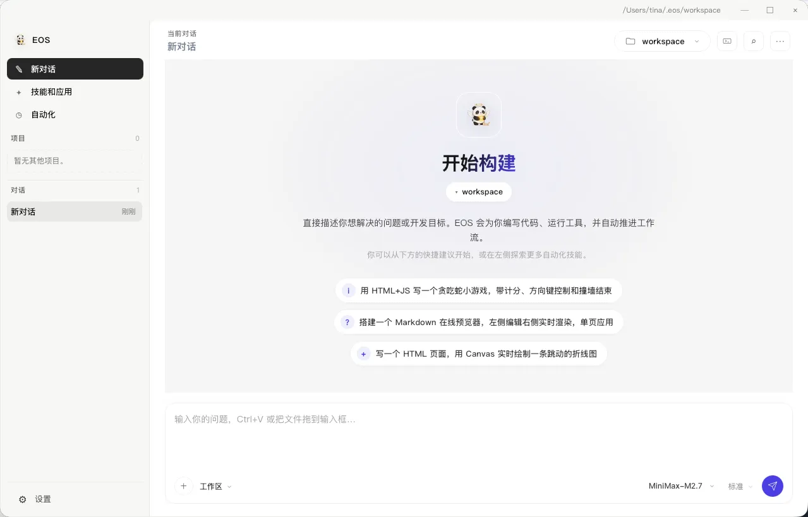

# EOS Agent

[中文](./README.md) | [English](./README.en.md)

**桌面端 AI 编程工作台。** 在同一个窗口与 AI 协作处理本地项目，并检查文件改动、命令输出和任务进度。

- 下载安装包：[Releases](https://github.com/eosaios/eos-app/releases)（始终以最新 Release 为准）
- 问题反馈：[Issues](https://github.com/eosaios/eos-app/issues)
- 终端版：[EOS CLI](https://github.com/eosaios/eos)

本仓库是 EOS Agent 的**官方发行仓**：提供安装包、版本说明与产品介绍，**不包含桌面端源码**。核心能力基于 [EOS CLI](https://github.com/eosaios/eos) 的 Rust 内核，官方发行包附带 Core 完整性校验（SHA-256 与 Ed25519 验签）。Core 校验与操作系统对安装包的签名验证是不同机制，后者以具体发行包为准。

## 为什么是 EOS Agent

在同一个工作台中处理项目对话、查看改动、运行终端命令，并使用可用的浏览器后端检查页面。

- **围绕任务协作**——对话、计划、任务与审批集中显示
- **浏览器协作**——导航、点击、填表与人工接管，后端能力因平台而异
- **检查改动**——查看 Git 状态、差异、命令输出与支持格式的产物预览
- **设置与维护**——主题、回复偏好、应用内更新检查与系统托盘

## 能力与运行条件

**对话与项目**

项目对话、附件、计划 / 自动模式、输入改写与回复片段采集；任务和计划待办、Git 状态与差异、提交 / 推送、工作树和远程仓库操作。Git、项目工具链与远程仓库认证需按任务准备。

**浏览器**

macOS / Windows 有原生内嵌浏览器宿主；Linux 默认使用独立浏览器引擎。支持的后端可用于导航、点击、填表与人工接管；具体动作取决于后端、浏览器运行环境及网站限制。例如 macOS 内嵌浏览器不支持通过浏览器工具直接导出 PDF，不能据此承诺三端功能逐项一致。

**权限与执行策略**

可配置审批、工具策略及沙箱档位。当前策略检查不能视作完整的操作系统隔离，保护范围以应用显示的后端状态为准。执行前后仍需核对命令与改动。

**模型、上下文与用量**

配置模型连接并测试连通性；管理规则、记忆和上下文。工具调用、视觉、推理控制与上下文上限依赖模型和接口。用量依赖服务商返回的数据；缺少用量或价格信息时，费用估算可能不可用，实际账单以服务商为准。

**扩展与自动化**

技能、MCP 连接、插件市场、主题及符合规范的本地 / GitHub 皮肤导入。市场安装与在线服务可能要求登录和相应权益；LSP 需要对应语言服务器。定时自动化仅在 EOS Agent 运行时调度，退出应用后不会继续执行。

**终端与桌面**

集成终端、系统托盘、单实例与桌面通知。Windows 终端需要可用的 Bash（如 Git for Windows），桌面运行可能需要 WebView2；Linux 需要兼容的 WebKit / GTK 桌面依赖。不同平台和发行版本的能力以对应发行说明为准。

## 平台与安装

| 平台 | 架构 | 安装方式 |
|---|---|---|
| Windows | x64 | setup 安装器，或便携 zip |
| macOS | Intel / Apple Silicon | dmg 拖拽安装，或便携 tar.gz |
| Linux | amd64 / arm64 | tar.gz |

1. 打开 [Releases](https://github.com/eosaios/eos-app/releases)，下载对应平台的最新安装包
2. 需要时用同页的 `SHA256SUMS.txt` 校验
3. 安装后可在应用内检查并下载更新，由用户发起安装。Windows / macOS 使用各自安装流程；Linux 打开下载目录后需自行解压替换。

> 发行物命名以每个 Release 页资产列表为准，版本号随发版自动更新，不在本文重复维护。

## 界面预览

### 演示视频（约 80 秒）

点击预览观看完整演示——对话协作、任务执行与文件生成。

以下为 macOS 示例界面；其他系统及发行版本的布局可能不同：

- 左侧：新对话、技能和应用、自动化，以及任务 / 工作树、用量 / 网络 / 记忆 / 帮助
- 中央：对话与主工作流
- 底部：发起新任务的输入区（可切换模型与推理强度），Bash 终端随附

## 许可证与费用

**桌面端源码不公开，官方二进制包可免费用于个人与商业工作。** 具体授权见 [LICENSE](./LICENSE)。

这份免费使用授权也适用于此前由 EOSAIOS 发布的官方未修改二进制包。旧安装包随附文件或历史版本快照可能仍保留先前条款，当前授权以[主分支许可证](https://github.com/eosaios/eos-app/blob/main/LICENSE)第六条第 2 项为准。

- 个人与组织均可免费下载安装、运行官方未修改安装包，用于企业内部工作、商业软件开发和收费客户项目，无需单独申请商业使用授权
- 原样分享官方安装包与公开文档时，请保留许可证、版权声明与官方来源
- 免费使用不授予桌面端源码权利，也不授权重新打包或销售 EOS Agent 软件本身
- 软件免费不包含模型 API 额度；自带 API Key 的费用与数据政策由所选服务商决定
- EOS CLI 独立发行版本遵循其自身许可证，本授权不改变第三方组件的许可证

## 首次使用与能力边界

1. 下载适合系统的官方安装包，在发行页核对版本说明和 SHA-256 校验文件。
2. 在模型设置中添加服务商接口、API Key 和模型，并测试连接。自带 API Key 的编程功能无需注册 EOS 账号；账号服务按各自要求登录。
3. 打开测试项目，选择执行权限，从一个小改动开始。检查差异、命令输出并运行项目测试，再决定是否采用结果。

模型请求发送到所配置的接口，可能包含消息、文件内容、项目上下文、命令输出和截图。网页、插件、MCP、更新和账号功能也可能联网；请确认所启用服务的数据政策。工具调用、视觉、上下文上限和推理能力依赖模型及接口。费用面板为估算，实际账单以服务商为准。审批和沙箱不能替代人工审查，也不保证任务结果正确。

## 联系

- 问题反馈：https://github.com/eosaios/eos-app/issues
- 合作 / 再分发授权咨询：legal@eosaios.com
